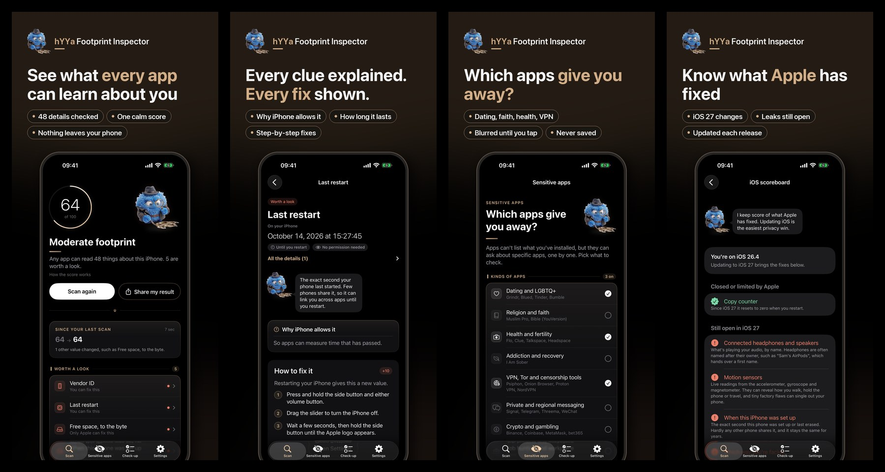

<p align="center">
  
</p>

<h1 align="center">hYYa Footprint Inspector</h1>

<p align="center">
  <b>See what any app can learn about your device, and how to hide it.</b><br>
  Free · Open source · Nothing leaves your device
</p>

<p align="center">
  <a href="LICENSE"></a>
  
  
  
  
  <a href="https://apps.apple.com/app/id6824033636"></a>
  
</p>

<p align="center"></p>

## Why

Every app you install can quietly read dozens of details about your device without asking:
- when it was set up, to the second
- when it last restarted
- your free space, to the byte
- your headphones' name, which often includes your first name
- your languages and keyboards

Each one looks harmless. Together they can recognise your device across apps, a technique called
**fingerprinting**. Grant a permission and an app can see far more.

hYYa Footprint Inspector reads exactly what any app can read, shows it to you in plain language,
flags what's worth a look, and walks you through hiding what can be hidden.

## What it does

- **Scan.** Checks dozens of details any app can read without asking, and gives one calm score
  that counts only what you can change.
- **Clues explained.** For each one: what an app learns, why the system allows it, and how long
  it lasts.
- **Fixes.** Short steps for what you can change, and an honest "only Apple can fix this" for
  the rest.
- **What apps see once you say yes.** Tap a permission (Location, Photos, Contacts, Calendars,
  Bluetooth, Local Network, Motion and more) to see exactly what an app gets. You're asked only
  when you tap.
- **Which apps give you away.** Apps can ask whether specific apps are installed. Choose the
  categories to check (dating, faith, health, VPN, messaging, crypto and more). Results are
  blurred until you tap and cleared when you leave. They stay on your device, and we have no
  access to them.
- **Permission check-up.** The system never tells one app which other apps can reach your data,
  so a guided walk through Settings does it instead.
- **Keep track.**
  - Before/after comparisons and a scoreboard of what has been fixed over time.
  - Scan history kept only on your device.
  - A share card that holds none of your personal details.

## Privacy

- **No account, no server, no analytics, no ads, no third-party SDKs.** The app uses only the
  platform's own frameworks.
- **Everything stays on your device, and we have no access to it.**
  - Scan history keeps scrambled markers, never the values.
  - Sensitive-app results are shown only to you. History can keep how many were found, never which.
  - No place names are looked up for your photos.
- **App Store privacy label: "Data Not Collected".** The Android app has no internet permission. Full policy:
  [hyya.com/privacypolicy/hyya-footprint-inspector.html](https://hyya.com/privacypolicy/hyya-footprint-inspector.html)

Read the code to check. That's why it's open source. Each store release has a matching tag, such
as [`v1.0.2`](https://github.com/hyya-dev/hYYa-Footprint-Inspector/releases/tag/v1.0.2).

## Building

Apple platforms: Xcode 27 or later,
[XcodeGen](https://github.com/yonaskolb/XcodeGen) (`brew install xcodegen`), iOS 26 or macOS 26.

```sh
xcodegen generate
xcodebuild -project hYYaFootprintInspector.xcodeproj -scheme "hYYa Footprint Inspector" \
  -destination "platform=iOS Simulator,name=iPhone 17 Pro" test
```

`project.yml` is the source of truth; the `.xcodeproj` is generated and not committed.

Android: open `Android/` in Android Studio, or run `./gradlew assembleDebug` there.

| Folder | What's in it |
|---|---|
| `App/Sources/Readers`, `App/Sources/Permissions` | How each signal is read |
| `App/Sources/Model` | What we say about each signal: meaning, persistence, severity, fix |
| `App/Sources/UI` | The interface (dark "Quiet Noir" look) |
| `App/Sources/MacReaders` | Mac-only readers |
| `Android/` | The Android app |
| `docs/` | Research and signal inventory |

## Contributing

Found a signal we miss, a wrong explanation or a better fix? See
[CONTRIBUTING.md](CONTRIBUTING.md). Security issues: [SECURITY.md](SECURITY.md).

## Licence

[Mozilla Public License 2.0](LICENSE).
- You may use this code in your own projects, including closed-source ones.
- Changes to *our* files must stay open under the same licence.
- The hYYa name, the mascot and the app icon are not covered by the licence. Please don't use
  them for your own builds.

Part of the [hYYa](https://hyya.com) family of privacy-first apps.
