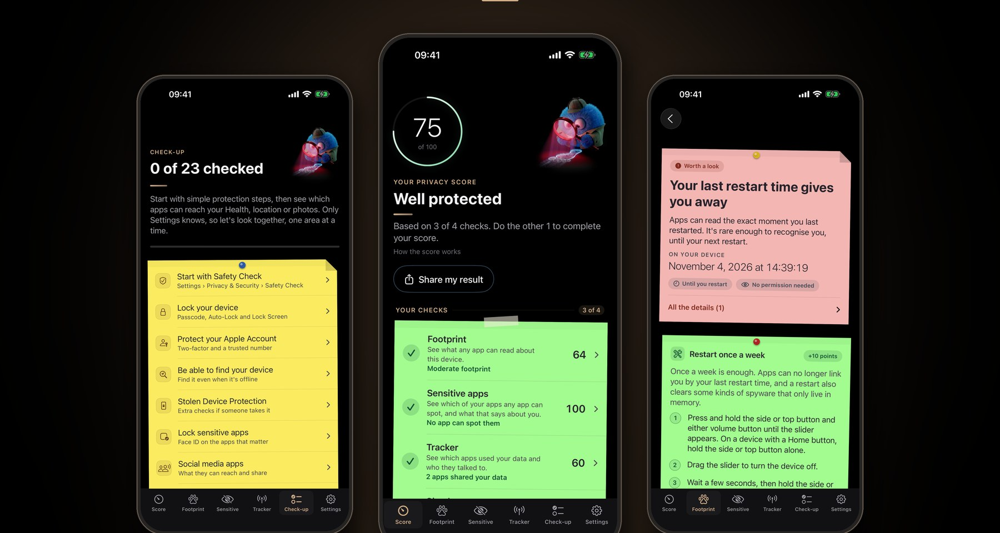

<p align="center">
  <picture>
    <source media="(prefers-color-scheme: dark)" srcset="docs/images/mascot-night.png">
    
  </picture>
</p>

<h1 align="center">hYYa Digital Footprint Check</h1>

<p align="center">
  <b>See what apps know about you. Then fix it.</b><br>
  Free · Open source · Nothing leaves your device
</p>

<p align="center">
  <a href="LICENSE"></a>
  
  
  
  
  <a href="https://apps.apple.com/app/id6824033636"></a>
  <a href="https://apps.apple.com/app/id6824033636?platform=mac"></a>
  <a href="https://play.google.com/store/apps/details?id=com.hyya.footprintinspector"></a>
</p>

<p align="center"></p>

## Why

Every app you install can quietly read dozens of details about your device without asking:
- when it was set up, to the second
- when it last restarted
- your free space, to the byte
- your headphones' name, which often includes your first name
- your languages and keyboards

Each one looks harmless. Together they can recognise your device across apps, a technique called
**fingerprinting**. Grant a permission and an app can see far more.

hYYa Digital Footprint Check reads exactly what any app can read, shows it to you in plain language,
flags what's worth a look, and walks you through hiding what can be hidden.

## What it checks

| Check | What it shows you | iPhone and iPad | Mac | Android |
|---|---|:---:|:---:|:---:|
| **Footprint** | Details any app can read without asking: device and system, storage, screen, sound and accessories, language and region, accessibility, sensors, network and security set-up, plus what survives deleting and reinstalling an app | ✓ | ✓, including the serial number, your full name and every installed app | ✓ |
| **What websites see** | What a web page can read about this device | ✓ | — | — |
| **Permissions** | What an app gets once you say yes, shown only when you tap: location, photos, contacts, calendars, Bluetooth and more | ✓ | ✓ | ✓ |
| **Sensitive apps** | Whether apps in categories you choose (dating, faith, health, VPN, messaging, crypto and more) can be spotted by other apps | ✓ | ✓ | ✓ |
| **Tracker** | Which apps used your data and who they talked to (from your own App Privacy Report on iPhone and iPad), or what holds special access (Android); on a Mac, where to look | ✓ | ✓ | ✓ |
| **Check-up** | A guided walk through Settings to take access back, step by step | ✓ | ✓ | ✓ |

## What it does

- **Scan.** Checks dozens of details any app can read without asking, and gives one calm score
  that counts only what you can change.
- **Clues explained.** For each one: what an app learns, why the system allows it, and how long
  it lasts.
- **Fixes.** Short steps for what you can change, and an honest "only Apple can fix this" for
  the rest.
- **What apps see once you say yes.** Tap a permission (Location, Photos, Contacts, Calendars,
  Bluetooth, Local Network, Motion and more) to see exactly what an app gets. You're asked only
  when you tap.
- **Which apps give you away.** Apps can ask whether specific apps are installed. Choose the
  categories to check (dating, faith, health, VPN, messaging, crypto and more). Results are
  blurred until you tap and cleared when you leave. They stay on your device, and we have no
  access to them.
- **Permission check-up.** The system never tells one app which other apps can reach your data,
  so a guided walk through Settings does it instead.
- **Keep track.**
  - Before/after comparisons and a scoreboard of what has been fixed over time.
  - Scan history kept only on your device.
  - A share card that holds none of your personal details.

## Privacy

- **No account, no server, no analytics, no ads, no crash reporting, no networking code.** On iPhone,
  iPad and Mac the app is built only from Apple's own frameworks. On Android it uses Google's
  open-source AndroidX and Jetpack libraries and Kotlin (see [THIRD-PARTY-NOTICES](THIRD-PARTY-NOTICES.md)).
- **Everything stays on your device, and we have no access to it.**
  - Scan history keeps scrambled markers, never the values.
  - Sensitive-app results are shown only to you. History can keep how many were found, never which.
  - No place names are looked up for your photos.
- **App Store privacy label: "Data Not Collected".** The Android app has no internet permission. Full policy:
  [hyya.com/privacypolicy/hyya-digital-footprint-check.html](https://hyya.com/privacypolicy/hyya-digital-footprint-check.html)

Read the code to check. That's why it's open source. Each store release has a matching tag and a
[GitHub Release](https://github.com/hyya-dev/hYYa-Digital-Footprint-Check/releases).

`App/Resources/AppNames.json` is offline lookup data: the names of the most-used apps from Apple's
public App Store charts, so the Tracker can show "Bolt" instead of a bundle ID. The app never looks
anything up and sends nothing.

### Installing on Android outside Google Play
The signed APK on each [GitHub Release](https://github.com/hyya-dev/hYYa-Digital-Footprint-Check/releases)
is signed with a different key from the Google Play version. Android won't update one with the other,
so pick one source and keep to it (uninstall first to switch).

## Building

Apple platforms: Xcode 27 or later,
[XcodeGen](https://github.com/yonaskolb/XcodeGen) (`brew install xcodegen`), iOS 26 or macOS 26.

```sh
xcodegen generate
xcodebuild -project hYYaFootprintInspector.xcodeproj -scheme "hYYa Footprint Inspector" \
  -destination "platform=iOS Simulator,name=iPhone 17 Pro" test
```

`project.yml` is the source of truth; the `.xcodeproj` is generated and not committed.

Android: open `Android/` in Android Studio, or run `./gradlew assembleDebug` there. Add
`-Pfdroid=true` for the F-Droid edition: it has no card pointing to other hYYa apps, and its rating
and share links go to this repository and the app's page on hyya.com instead of Google Play.

| Folder | What's in it |
|---|---|
| `App/Sources/Readers`, `App/Sources/Permissions` | How each signal is read |
| `App/Sources/Model` | What we say about each signal: meaning, persistence, severity, fix |
| `App/Sources/UI` | The interface (dark "Quiet Noir" look) |
| `App/Sources/MacReaders` | Mac-only readers |
| `Android/` | The Android app |
| `docs/` | Research and signal inventory |

## Contributing

Found a signal we miss, a wrong explanation or a better fix? See
[CONTRIBUTING.md](CONTRIBUTING.md). Security issues: [SECURITY.md](SECURITY.md).

## Licence

[Mozilla Public License 2.0](LICENSE).
- You may use this code in your own projects, including closed-source ones.
- Changes to *our* files must stay open under the same licence.
- The hYYa name, the mascot and the app icon are not covered by the licence. See
  [TRADEMARKS.md](TRADEMARKS.md): forks must rebrand.

## About hYYa

Made by [hYYa Apps](https://hyya.com/about.html), the studio from hYYa LLC, which builds
privacy-first apps.
